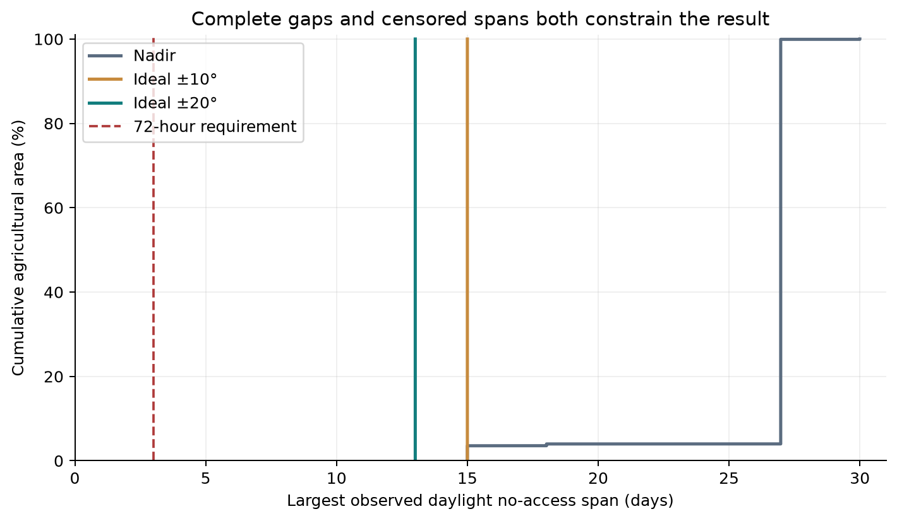
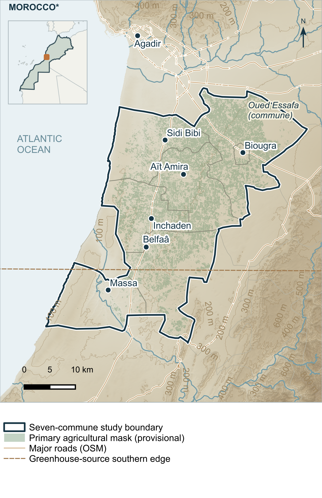
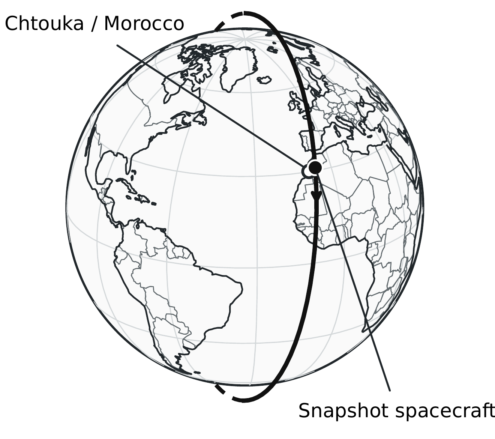

# AtlasSAT-16U-SWM1
### Souss Water Management 1

A conceptual **16U Earth-observation spacecraft** for agricultural production and water-management needs in Souss-Massa, Morocco, with emphasis on the Chtouka-Massa plain south of Agadir.

This parent spacecraft repository currently contains [Study 2A — orbital analysis](studies/2A-orbital-analysis/README.md). The satellite has not been built, launched or operationally qualified. **Version 1.0.0 is the first public edition of this engineering portfolio and its reproducible examples.**

## Engineering publications

| Document | Accepted scientific baseline | Public copy |
|---|---|---|
| **2A — Portfolio summary** | RevD3.4 · one A4 page | [Read PDF](studies/2A-orbital-analysis/documents/AtlasSAT_2A_Orbital_Analysis_OnePager_RevD3_4_Public_RC_v0_2.pdf) · [TeX](studies/2A-orbital-analysis/documents/AtlasSAT_2A_Orbital_Analysis_OnePager_RevD3_4_Public_RC_v0_2.tex) |
| **2A-1 — Orbital verification, coverage and revisit** | RevD3.5 · 21 pages | [Read PDF](studies/2A-orbital-analysis/documents/AtlasSAT_2A-1_Orbital_Analysis_RevD3_5_Public_RC_v0_2.pdf) · [TeX](studies/2A-orbital-analysis/documents/AtlasSAT_2A-1_Orbital_Analysis_RevD3_5_Public_RC_v0_2.tex) |
| **2A-2 — Analytical derivations and independent verification** | v0.2.1 · 49 pages | [Read PDF](studies/2A-orbital-analysis/documents/AtlasSAT_2A-2_Analytical_Derivations_v0.2.1_Public_RC_v0_2.pdf) · [TeX](studies/2A-orbital-analysis/documents/AtlasSAT_2A-2_Analytical_Derivations_v0.2.1_Public_RC_v0_2.tex) |

These are distinctly named **public-distribution derivatives**. Their scientific body, equations, approved visual assets and accepted layout are preserved. Changes concern missing source notices, relative destinations and explicit availability of internal evidence. The author-approved professional email remains. See [publication differences](PDF_PUBLICATION_DIFF.md).

## Principal result — the 72-hour target is not met

The complete agricultural study reports a **312.22 h maximum complete daylight no-access gap**, even under the nominal 30 km swath and ideal independent ±20° roll assumption. The maximum belongs to an agricultural target in **Sidi Bibi**, not the historical reference point. Mean coverage is not a guarantee: the worst 72-hour rolling daylight windows reach **0%**.

This is useful negative engineering evidence for later design trades. It is a numerical/geometric finding under stated assumptions, not measured flight performance.

## Spacecraft and observation concept

| Item | Preserved baseline / assumption |
|---|---|
| Spacecraft | Conceptual AtlasSAT-16U; 24 kg model dry mass |
| Orbit | Approximately 550 km; 97.5° inclination; target 10:30 local mean descending-node time |
| Native propagation | GMAT R2026a; Earth JGM2 degree 2/order 0; 30-day nominal scenario; original seven-day verification retained internally |
| Imager | Five-band VNIR pushbroom concept; nominal 30 km nadir swath; target nadir GSD 5–10 m |
| Optical model | Provisional 10 m along-track ground sample; GSD, optical IFOV and line acquisition rate are distinct |
| Pointing | Nadir reference; ideal independent ±10°/±20° roll sensitivity, not qualified ADCS or a feasible schedule |
| Agricultural region | Provisional seven-commune research boundary and primary mask; official institutional agricultural geometry and field validation remain unavailable |

### Geographic and orbital context

<table><tr>
<td></td>
<td></td>
</tr></table>

Map data © OpenStreetMap contributors — https://www.openstreetmap.org/copyright. Natural Earth context is public domain. © ESA WorldCover project 2021 / Contains modified Copernicus Sentinel data (2021) processed by ESA WorldCover consortium. WorldCereal and Global-PCG-10 credits and CC BY notices are retained in the [figure notices](studies/2A-orbital-analysis/figures/README.md).

Relief produced using Copernicus WorldDEM-30 © DLR e.V. 2010–2014 and © Airbus Defence and Space GmbH 2014–2018, provided under COPERNICUS by the European Union and ESA; all rights reserved. The organisations in charge of the Copernicus programme by law or by delegation do not incur any liability for any use of the Copernicus WorldDEM-30.

The approved coastline, mask, locator, orbit geometry and figure composition were not changed. [Passage maps and source credits](studies/2A-orbital-analysis/figures/README.md) distinguish orbital passage, geometric target reachability and daylight opportunity. Basemap imagery does not portray simulated event-time weather.

## GMAT model and independent Python analysis

The [human-readable native mission](studies/2A-orbital-analysis/simulation/GMAT/AtlasSAT_Nominal_30days_GUI.script) remains the engineering configuration. Python reads an explicitly selected OEM for time/frame conversion, continuous optical-event geometry and statistics. It does not silently launch GMAT or manufacture a mission.

The public subset includes:
- Canonical OEM, geometry, optical-access and metric modules, plus a 23-function independent analytical subset.
- Controlled parser/geometry and closed-form numerical examples.
- Six genuine saved daylight windows demonstrating exact-gap reaggregation.
- Selected saved numerical records, comparison CSV and unchanged publication figures.

**The public examples do not reproduce the full private agricultural study.** Full target databases, raster/vector sources, kernels and complete native/access reference products remain excluded. [Reproducibility scope](REPRODUCIBILITY_SCOPE.md) separates runnable demonstrations, archived results and the internal complete workflow.

## Run the public examples — tested Python 3.12

With Python 3.12 and its Windows launcher installed, run from the repository root:

    py -3.12 -m venv .venv
    .\.venv\Scripts\python.exe -m pip install -r studies/2A-orbital-analysis/requirements-public.txt
    .\.venv\Scripts\python.exe -B studies/2A-orbital-analysis/examples/controlled_geometry.py
    .\.venv\Scripts\python.exe -B studies/2A-orbital-analysis/examples/analytical_checks.py
    .\.venv\Scripts\python.exe -B studies/2A-orbital-analysis/examples/replay_saved_gap.py
    .\.venv\Scripts\python.exe -B -m unittest discover -s studies/2A-orbital-analysis/tests -v

All post-bootstrap commands explicitly use that environment. The suite has **39 tests**; the exact analytical function-source hashes remain unchanged. Structural identity no longer depends on interpreter-specific AST dump formatting. [Detailed example instructions](studies/2A-orbital-analysis/docs/REPRODUCING_PUBLIC_EXAMPLES.md) and [publication rebuild instructions](studies/2A-orbital-analysis/documents/BUILD_PUBLICATIONS.md) provide the separate workflows.

## What the evidence establishes

Numerical verification checks implementation consistency. Geometric reachability and daylight optical opportunity add modelled constraints. **Physical and operational mission validation is not established**: no guaranteed imagery, cloud/terrain/image-quality qualification, flight ADCS performance or observation schedule is claimed.

Provisional agricultural geometry, incomplete southern greenhouse coverage, predicted Earth orientation and ideal roll remain material caveats. The initial-TA sensitivity is not a pure phase shift at fixed mean orbit. The inherited v0.2 archive exception remains disclosed.

The [repository tree](REPOSITORY_TREE.txt), [QA report](QA_REPORT.md), [file ledger](PUBLIC_FILE_SELECTION.csv), [attribution audit](CARTOGRAPHIC_ATTRIBUTION_AUDIT.md) and [public evidence index](studies/2A-orbital-analysis/documents/PUBLIC_EVIDENCE_AVAILABILITY.md) support review. Future studies may extend this parent project; no empty study folders or newly completed constellation, ADCS or communications work are presented.

Mission framing, engineering objectives and review: Wassim Ait Oubahou. Implementation/documentation received Codex assistance. **The author's copyright position is unchanged; no project licence is introduced or changed.** Existing third-party notices remain applicable.
