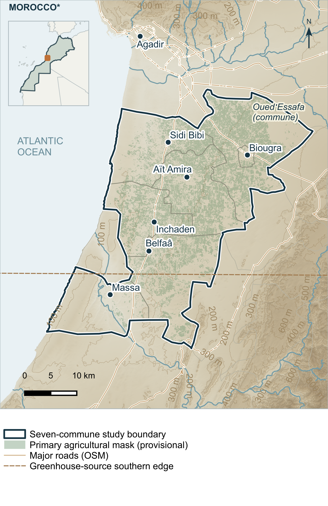
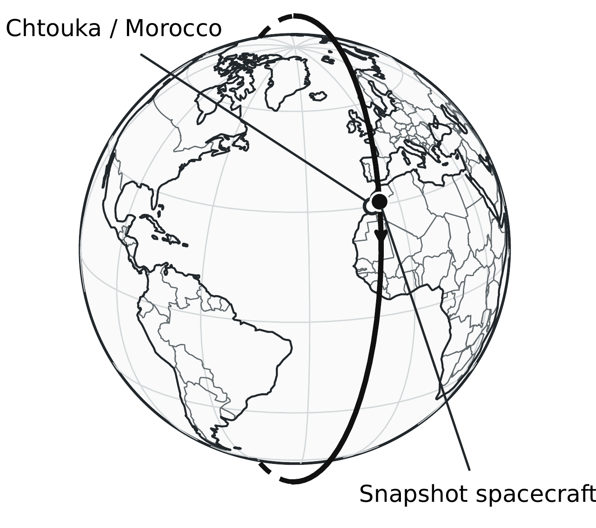

# AtlasSAT-16U-SWM1

Souss Water Management 1 is a conceptual 16U Earth observation spacecraft for agricultural and water management applications in Souss-Massa, Morocco. Study 2A assesses whether a single spacecraft can provide daylight optical opportunities over the Chtouka-Massa agricultural plain within a 72-hour revisit requirement.

## Study 2A · Orbit, optical access and revisit

GMAT R2026a propagates the nominal 30-day orbit at approximately 550 km in a J2 Earth gravity model. Independent Python analysis transforms the exported ephemeris to terrestrial coordinates and solves for pushbroom footprint crossings at agricultural targets. The nadir case uses a nominal 30 km swath. Ideal ±10° and ±20° roll cases test reachability. The analytical companion checks selected orbital, optical and revisit calculations.

**The ≤72-hour daylight revisit requirement is NOT MET.** The maximum complete daylight gap was **312.22 h** at an agricultural target in Sidi Bibi in the ideal ±20° case. The minimum area coverage across rolling 72-hour daylight windows was **0%** for that case. See the [study methods and results](studies/2A-orbital-analysis/README.md) and [saved result summary](studies/2A-orbital-analysis/data/published_results.json).

The agricultural mask is provisional and the southern greenhouse source has incomplete coverage. Earth orientation includes predictions. Geometric reachability and daylight opportunity are modelled quantities. Flight, payload, attitude control, image quality and operational scheduling validation remain outside the study's evidence.

<table><tr>
<td></td>
<td></td>
</tr></table>

Map data © OpenStreetMap contributors — https://www.openstreetmap.org/copyright. Natural Earth context is public domain. © ESA WorldCover project 2021 / Contains modified Copernicus Sentinel data (2021) processed by ESA WorldCover consortium. WorldCereal and Global-PCG-10 credits and CC BY notices are retained in the [figure notices](studies/2A-orbital-analysis/figures/README.md).

Relief produced using Copernicus WorldDEM-30 © DLR e.V. 2010–2014 and © Airbus Defence and Space GmbH 2014–2018, provided under COPERNICUS by the European Union and ESA; all rights reserved. The organisations in charge of the Copernicus programme by law or by delegation do not incur any liability for any use of the Copernicus WorldDEM-30.

## Publications

| Document | Revision | PDF |
|---|---|---|
| 2A · Portfolio summary | RevD3.4 · editorial revision 1 | [Read](studies/2A-orbital-analysis/documents/AtlasSAT_2A_Orbital_Analysis_OnePager_RevD3_4_Editorial_Rev1.pdf) |
| 2A-1 · Orbital verification, coverage and revisit | RevD3.5 · editorial revision 1 | [Read](studies/2A-orbital-analysis/documents/AtlasSAT_2A-1_Orbital_Analysis_RevD3_5_Editorial_Rev1.pdf) |
| 2A-2 · Analytical derivations and independent verification | v0.2.1 · editorial revision 1 | [Read](studies/2A-orbital-analysis/documents/AtlasSAT_2A-2_Analytical_Derivations_v0.2.1_Editorial_Rev1.pdf) |

## Code and reproducibility

- [GMAT mission configuration and usage](studies/2A-orbital-analysis/docs/GMAT_GUI.md)
- [Python setup, numerical examples and test commands](studies/2A-orbital-analysis/docs/REPRODUCING_PUBLIC_EXAMPLES.md)
- [Reproducibility scope](REPRODUCIBILITY_SCOPE.md) and [public evidence index](studies/2A-orbital-analysis/documents/PUBLIC_EVIDENCE_AVAILABILITY.md)

The included examples cover controlled optical geometry, analytical formula checks and reaggregation of six saved daylight windows. Full agricultural coverage reproduction requires the internal geographic databases, kernels and reference products.

## Provenance

Wassim Ait Oubahou defined the mission and engineering objectives, directed the agricultural region definition and reviewed the study. See [contributions and attribution](ATTRIBUTION.md), [citation metadata](CITATION.cff) and [publication history](PUBLICATION_HISTORY.md).
