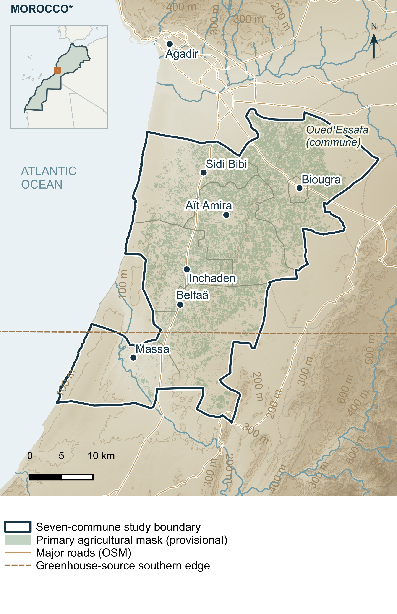
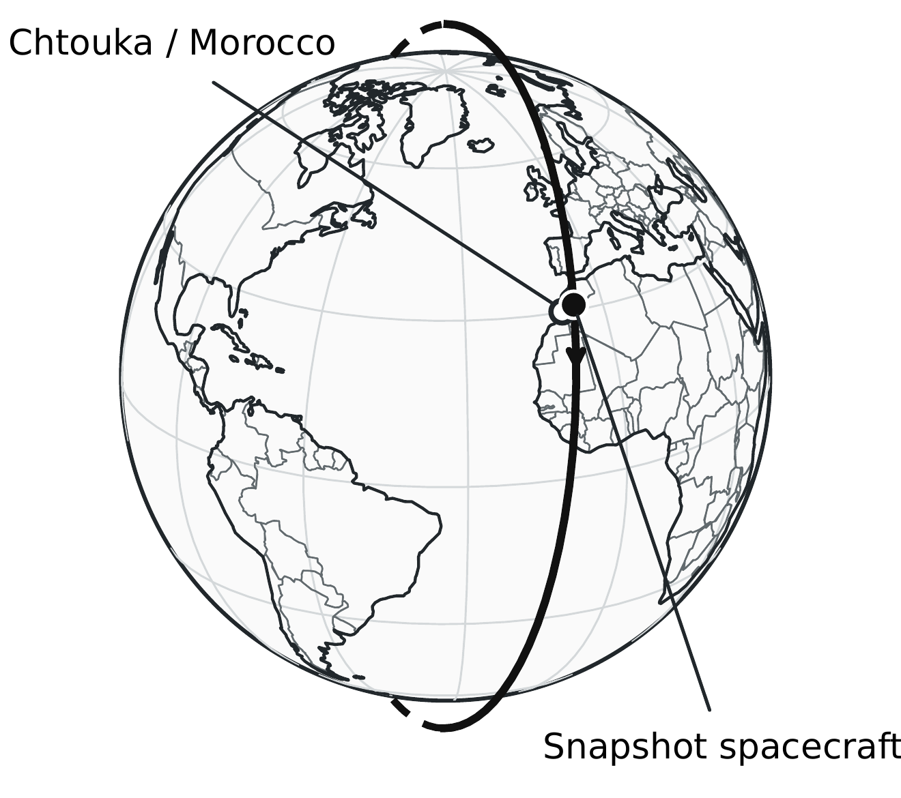
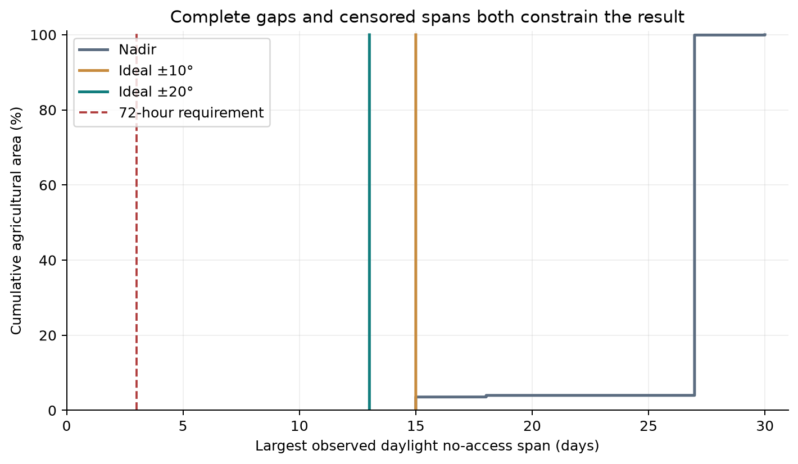

# Study 2A — Orbital Analysis

[AtlasSAT-16U-SWM1](../../README.md) / **Study 2A**

**Orbit propagation · Optical access · Daylight revisit · Analytical verification**

Study 2A evaluates whether the reference single-spacecraft configuration can provide daylight optical access to agricultural targets in the Chtouka-Massa plain, Souss-Massa, Morocco, within a **72-hour revisit requirement**. The analysis combines a native GMAT orbit model, Python-based geometry and coverage calculations, and an analytical verification companion.

**Finding:** The reference configuration **does not meet** the ≤72 h daylight revisit requirement. The maximum complete daylight no-access interval is **312.22 h** for the nominal 30 km swath with ideal independent ±20° roll.

[One-page summary (2A)](documents/AtlasSAT_2A_Orbital_Analysis_OnePager_RevD3_4_Editorial_Rev1.pdf) · [Detailed report (2A-1)](documents/AtlasSAT_2A-1_Orbital_Analysis_RevD3_5_Editorial_Rev1.pdf) · [Analytical verification (2A-2)](documents/AtlasSAT_2A-2_Analytical_Derivations_v0.2.1_Editorial_Rev1.pdf)

## 1. Study objective and reference configuration

The mission concept uses a five-band visible and near-infrared (VNIR) pushbroom payload for agricultural and water-resource monitoring. Study 2A examines orbital geometry and the availability of daylight observation opportunities; it does not evaluate image quality or a feasible spacecraft tasking schedule.

| Parameter | Reference model |
|---|---|
| Orbit | Approximately 550 km near-Sun-synchronous LEO; inclination 97.5° |
| Initial epoch | 20 October 2026, 12:00 UTC |
| Initial elements | SMA 6928.1363 km; eccentricity 0.001; RAAN 6.463170753756° |
| Local-time target | Approximately 10:30 local mean time of descending node at the reference epoch |
| Propagation | GMAT R2026a; Earth JGM2 gravity, degree 2 / order 0 (J2 only) |
| Simulation span | 30 days; CCSDS OEM export at 30 s cadence |
| Payload geometry | Nominal 30 km nadir swath; provisional 10 m along-track ground sample |
| Imaging requirement | Target nadir GSD 5–10 m; not a verified instrument performance |
| Pointing cases | Nadir and ideal independent ±10° / ±20° roll |
| Geographic sample | Provisional seven-commune agricultural research mask; 14,494 weighted target points in saved results |

The GMAT model uses an idealised gravity environment with drag, solar radiation pressure, tides, relativity and third-body forces disabled. The initial RAAN is selected for the reference local time; changing the orbit or epoch does not automatically preserve that local time. See the [GMAT configuration and run guide](docs/GMAT_GUI.md).

## 2. Study area

The agricultural mask is a provisional research dataset, not an official or field-validated land-use boundary. The regional map combines geographic context with agricultural screening inputs; incomplete greenhouse-source coverage in the south is a documented limitation.

*Figure 1 — Chtouka-Massa regional technical atlas. The map represents the study's provisional geographic inputs, not a final operational target database. Source credits appear below and in the [figure notices](figures/README.md).*

## 3. Analysis method

The study separates orbit propagation from optical-access postprocessing. The GMAT mission defines the reference spacecraft state and propagation model; the Python implementation reads an explicitly selected exported ephemeris rather than controlling GMAT or silently substituting archived data.

| Stage | Method and implementation |
|---|---|
| **01 — Orbit propagation** | [GMAT mission](simulation/GMAT/AtlasSAT_Nominal_30days_GUI.script): numerical J2 propagation and native reports |
| **02 — Ephemeris transfer** | CCSDS OEM in UTC / EarthMJ2000Eq (EME2000), with Cartesian positions and velocities in km and km/s; [OEM reader](src/atlas_analysis/oem.py) |
| **03 — Reference frames** | [ERFA/SPICE transformation](src/atlas_analysis/frames.py) to ITRF93 using specified time/orientation resources and source checks |
| **04 — Optical geometry** | [Continuous boundary search](src/atlas_analysis/optical_access.py) for a rectangular pushbroom angular footprint, with nadir and ideal roll sensitivities |
| **05 — Access and coverage** | [Revisit and rolling-window metrics](src/atlas_analysis/metrics.py): daylight filtering, no-access gaps, censored endpoints and area-weighted coverage |
| **06 — Verification** | [Analytical formula subset](src/atlas_analytical/formulae.py), [comparison record](evidence/ANALYTICAL_COMPARISON.csv) and numerical tests |

The [analysis pipeline](src/atlas_analysis/pipeline.py) implements the OEM-to-results interface. Terrestrial states are interpolated to refine along-track and cross-track footprint boundaries. Daylight opportunities apply a geometric solar-centre elevation threshold of at least 0°, evaluated at entry, midpoint and exit; higher solar-elevation sensitivity is documented separately.

A **complete no-access gap** is measured from the end of one access window to the beginning of the next. This is not the same quantity as the time between opportunity midpoints. Left- and right-censored record edges, and targets with no access, are tracked separately.

*Figure 2 — Reference orbital geometry. The globe is an illustration of the model, not an optical-coverage or mission-operations validation.*

## 4. Numerical findings

The saved Study 2A results evaluate daylight opportunities for the nominal 30 km swath across the provisional agricultural target set. The following values describe the **area-weighted fraction of the agricultural mask reached within rolling 72-hour windows**, not the percentage of acquired or usable images.

| Pointing case | Mean rolling 72 h daylight coverage | Minimum rolling 72 h daylight coverage |
|---|---:|---:|
| Nadir | 11.48% | 0% |
| Ideal ±10° roll | 22.76% | 0% |
| Ideal ±20° roll | 33.44% | 0% |

In the ideal ±20° case, the **maximum complete daylight no-access interval is 312.22 h** at a sampled agricultural target in **Sidi Bibi**. The historical reference point is excluded from the agricultural worst-gap calculation.

**Requirement assessment: ≤72 h — NOT MET.** Higher average area coverage with ideal roll does not eliminate long complete access gaps, nor does it demonstrate that independent target opportunities can be scheduled by a real attitude-control system.

*Figure 3 — Saved daylight-access gap evidence. Complete gaps and record-edge censoring are distinct measures.*

The numerical values above come from the [saved results](data/published_results.json), with supporting [result traceability](evidence/RESULT_TRACEABILITY.csv) and the [full 2A-1 report](documents/AtlasSAT_2A-1_Orbital_Analysis_RevD3_5_Editorial_Rev1.pdf). The public examples do **not** independently regenerate the complete 14,494-point agricultural result set.

## 5. Verification and reproducibility

The repository includes native mission and analysis source code, selected saved evidence, controlled numerical demonstrations and a documented **39-test public suite**. These form different levels of evidence and should not be confused with reproduction of the original complete study.

| Publicly available | What it demonstrates | Boundary |
|---|---|---|
| [Controlled geometry example](examples/controlled_geometry.py) | OEM parsing, synthetic narrow-window geometry and illumination checks | Artificial input; not a real GMAT ground track |
| [Analytical example](examples/analytical_checks.py) | Selected orbital formula comparisons against controlled cases | Does not rerun GMAT or the full analytical companion |
| [Saved-gap example](examples/replay_saved_gap.py) | Reaggregation of six saved daylight windows to the 312.219958 h complete gap | Reuses archived events; does not independently discover access windows |
| [Python tests](tests/) | Parser, geometry, metrics and public example checks | No full agricultural ROI regression |
| [GMAT mission](simulation/GMAT/AtlasSAT_Nominal_30days_GUI.script) | Inspectable native reference propagation setup | GMAT and model resources required to generate new states |

The [public reproduction guide](docs/REPRODUCING_PUBLIC_EXAMPLES.md) provides pinned software versions, Windows/POSIX commands and expected example outputs. The [reproducibility scope](../../REPRODUCIBILITY_SCOPE.md) and [evidence index](documents/PUBLIC_EVIDENCE_AVAILABILITY.md) distinguish included files from internal reference inputs.

Complete agricultural analysis additionally requires the original geographic targets, reference kernels, ephemerides and validated configuration. Those inputs are not included in the public subset. A successful public unit test or replay of saved intervals is not a claim of complete independent scientific reproduction.

## 6. Publications and source material

| Document | Description | Extent |
|---|---|---:|
| **[2A — Orbital Analysis Summary](documents/AtlasSAT_2A_Orbital_Analysis_OnePager_RevD3_4_Editorial_Rev1.pdf)** | Mission assumptions, selected findings and requirement verdict | 1 page |
| **[2A-1 — Orbital Verification, Coverage and Revisit](documents/AtlasSAT_2A-1_Orbital_Analysis_RevD3_5_Editorial_Rev1.pdf)** | Propagation, access methodology, coverage, sensitivity studies and numerical evidence | 21 pages |
| **[2A-2 — Analytical Derivations and Independent Verification](documents/AtlasSAT_2A-2_Analytical_Derivations_v0.2.1_Editorial_Rev1.pdf)** | Mathematical derivations, independent checks and limitations | 49 pages |

The repository's [GMAT simulation](simulation/GMAT/), [Python modules](src/), [figures](figures/), [saved records](data/) and [evidence](evidence/) are organised separately from the PDF publications. [Analytical cross-references](documents/ANALYTICAL_CROSS_REFERENCES.md) identify the corresponding passages and checks.

## 7. Modelling limitations

- **Orbit and orientation:** A preliminary J2-only model and predicted Earth orientation do not represent full orbit-determination or geographic uncertainty.
- **Optical geometry:** The 10 m along-track sample is provisional and distinct from optical IFOV and instrument line rate. Ideal roll bounds describe independent per-target reachability, not slew feasibility or a coherent observation schedule.
- **Study geography:** The agricultural mask has no local field validation. Missing southern greenhouse-source coverage affects 22.04% of the outer study boundary and 6.861% of the primary mask.
- **Measurement scope:** No cloud screening, atmospheric image-quality model, qualified payload, attitude-control verification or delivered-imagery service is established.
- **Historical evidence:** Initial true-anomaly sensitivity and the documented seven-day archive exception require the qualifications recorded in the scientific report.

The [scientific limitations register](evidence/SCIENTIFIC_LIMITATIONS.md) and [assumptions record](evidence/ASSUMPTIONS_AND_LIMITATIONS.md) provide the detailed interpretation.

## 8. Figures and data attribution

Map data © [OpenStreetMap contributors](https://www.openstreetmap.org/copyright) (ODbL). Natural Earth context is public domain. © ESA WorldCover project 2021 / Contains modified Copernicus Sentinel data (2021) processed by ESA WorldCover consortium. WorldCereal and Global-PCG-10 source credits and CC BY notices are maintained in the [figure documentation](figures/README.md).

Relief produced using Copernicus WorldDEM-30 © DLR e.V. 2010–2014 and © Airbus Defence and Space GmbH 2014–2018, provided under COPERNICUS by the European Union and ESA; all rights reserved. The organisations in charge of the Copernicus programme by law or by delegation do not incur any liability for any use of the Copernicus WorldDEM-30.

See [figure and dataset source notices](figures/README.md) and [project contributions](../../ATTRIBUTION.md).
